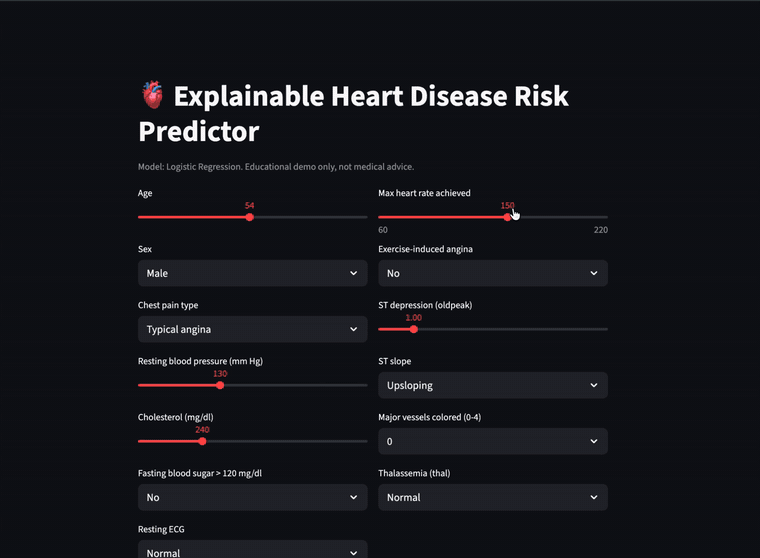

 Explainable Heart Disease Risk Predictor

A small end-to-end ML project: compare three classifiers on the UCI heart disease data, explain predictions with **SHAP**, and serve it through a **Streamlit** app where you enter patient values and see both a risk score and *why* the model produced it.

> Educational project. Not a medical device and not medical advice.

## Demo

<!-- Add a GIF or screenshot of the app here:  -->

## What it does

- Cleans the 13-feature heart disease table (drops duplicates and missing rows)
- Compares **Logistic Regression**, **Random Forest** and **XGBoost** with 5-fold stratified cross-validation, then evaluates on a held-out 20% test set
- Selects the best model by **cross-validated AUC**, not by test score, to avoid picking on the test set
- Generates global SHAP explanations (summary and importance plots)
- Serves a Streamlit app with a per-patient SHAP waterfall chart

## Results

Run `python train.py` and paste the table from `models/results.md` here:

| Model | CV AUC (mean) | CV AUC (std) | Test Accuracy | Test F1 | Test AUC |
|---|---|---|---|---|---|
| _fill in after training_ | | | | | |

Figures are written to `figures/` (`roc_curves.png`, `shap_summary.png`, `shap_importance.png`).

## Quickstart

```bash
git clone <your-repo-url>
cd heart-risk-explainer
python -m venv .venv && source .venv/bin/activate
pip install -r requirements.txt

# put the dataset at data/heart.csv (see data/README.md)
python train.py
streamlit run app.py
```

## Project structure

```
train.py          # train, compare, select, explain
app.py            # Streamlit app
data/             # put heart.csv here (not committed)
models/           # saved model + results table
figures/          # ROC and SHAP plots
```

## Limitations

- Small dataset (a few hundred patients), so metrics have wide uncertainty
- Data comes from specific clinical sites and may not generalise to other populations
- SHAP shows what the model relies on, not causal effects
- Intended for learning, not clinical use

## Next steps

- Calibration curves and threshold tuning for recall
- Hyperparameter search with nested CV
- Merge multi-site heart datasets and test cross-site generalisation

## Tech

Python, scikit-learn, XGBoost, SHAP, Streamlit, pandas, matplotlib
